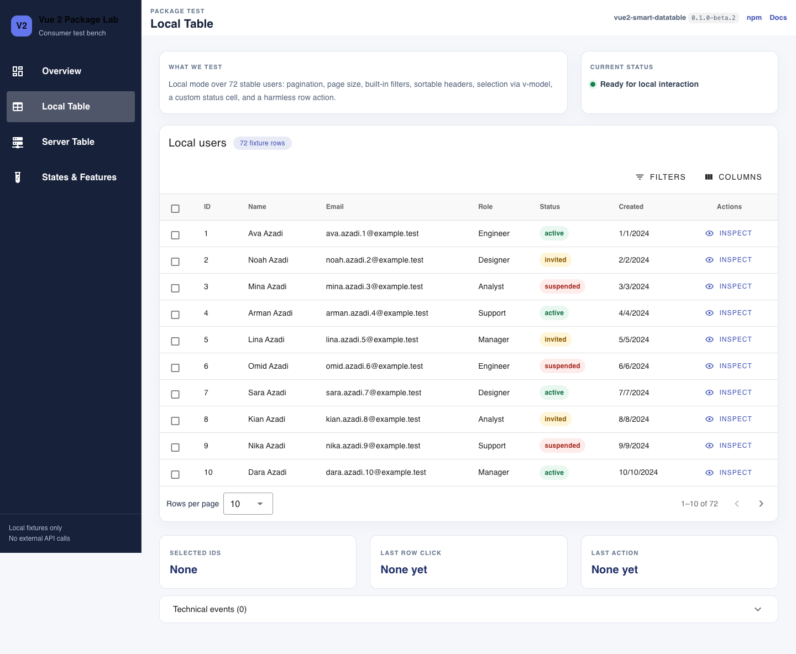
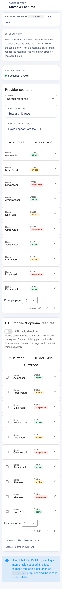

# Vue 2 Package Lab

A standalone consumer test bench for published Vue 2 packages. The first package under test is the npm release `vue2-smart-datatable@0.1.0-beta.2`—not a copied component or local source link. All users and the `/api/users` endpoint are deterministic local fixtures; this repository contains no company API, credentials, authentication integration, or private data.

**Current verified results, package findings, and untested areas: [read TEST_REPORT.md](./TEST_REPORT.md).**

## Quickstart

Requirements: Node.js 20 or newer and npm.

```sh
cd vue2-package-lab
npm ci
npx playwright install chromium
npm run dev
```

Open <http://127.0.0.1:4173>. The Playwright installation command downloads the browser version managed by the pinned `@playwright/test` dependency, so tests do not depend on a system Chrome installation.

## Architecture

The app intentionally keeps package-specific pages separate from reusable fixtures, mock transport, and scenario configuration:

```text
src/
├── app/                 # shared application shell and page intro
├── fixtures/            # deterministic local users
├── mock-api/            # Vite middleware for GET /api/users
├── pages/               # the four routed test workspaces
└── table-scenarios/     # shared columns, provider and normalization
tests/e2e/               # browser-level consumer tests
```

The four pages are:

- `/` — package version, stack, links, scope, and scenario overview.
- `/local` — local filtering, sorting, pagination, page size, selection, slots, and row actions over 72 rows.
- `/server` — a real `fetch('/api/users')` provider boundary, query mapping, latency, cancellation, request telemetry, loading, and errors.
- `/scenarios` — empty/error/retry/slow/race states plus RTL, responsive rendering, column persistence, selection, and CSV export.

## Commands and tests

```sh
npm run dev         # Vite development server on 127.0.0.1:4173
npm run typecheck   # vue-tsc --noEmit
npm run build       # typecheck plus production bundle
npm run preview     # production preview on 127.0.0.1:4174
npm run test:e2e    # all Playwright tests using managed Chromium
```

On a fresh machine or after changing Playwright versions, run `npx playwright install chromium` before `npm run test:e2e`. Linux CI uses `npx playwright install --with-deps chromium` to install Chromium and its OS dependencies.

Browser coverage includes all routes, local and server table behavior, empty/error/Retry, stale-response protection, persistence, CSV download, 360 px mobile, 768 px tablet, and RTL. Detailed outcomes and known package issues are recorded in [TEST_REPORT.md](./TEST_REPORT.md).

## Mock API and GitHub Pages

`GET /api/users` is implemented as middleware in `vite.config.ts` and is available only while the Vite development or preview server is running. A GitHub Pages deployment is static and cannot execute that middleware. Consequently, `/server` and provider-backed scenarios will not work on Pages without a separately deployed API or a deliberate static/mock transport redesign. This repository does not configure Pages, a remote, or any external service.

## Screenshots

Desktop local table:



Mobile states and features page:



## Publication safety

Generated dependencies and output (`node_modules`, `dist`, Playwright reports, test results, coverage and local `.tools`) are ignored. Environment files, local npm credentials, keys and certificates are also ignored. The two screenshots and the deterministic `example.test` fixture data are intentional repository content.

`package.json` deliberately keeps `"private": true`. That prevents accidental publication to the npm registry; it does not prevent making this GitHub repository public.

## License

Released under the [MIT License](./LICENSE). Copyright © 2026 Mohammad Reza Dehghani.
